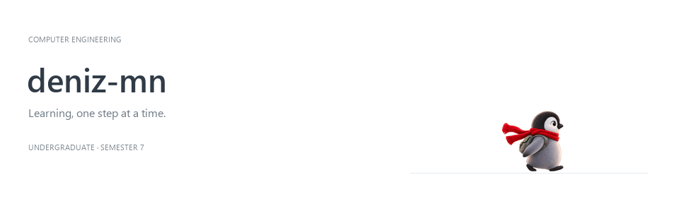

  

  Seventh-semester Computer Engineering undergraduate

---

### About

I'm a seventh-semester Computer Engineering undergraduate with project experience across different areas of computing, including artificial intelligence and software development. I enjoy connecting ideas, exploring new problems, and turning what I learn into working projects.

  Explore. Build. Understand.

